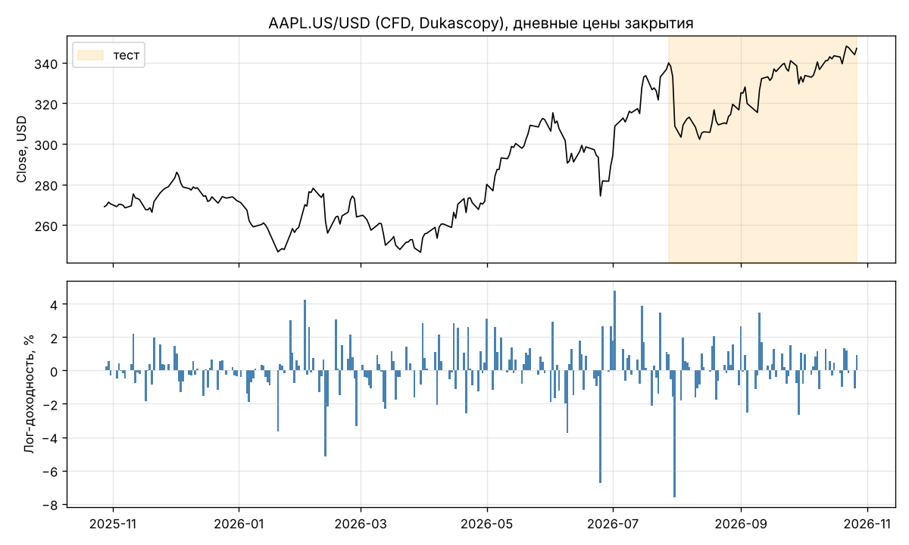
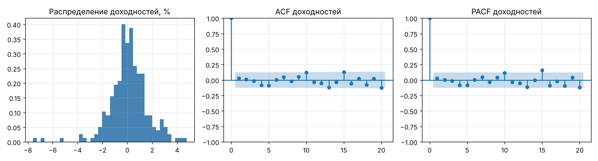
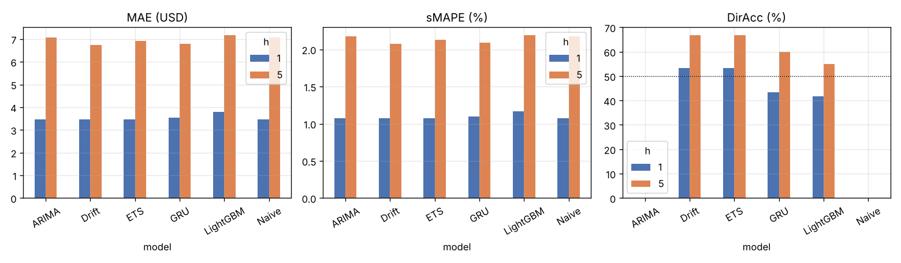
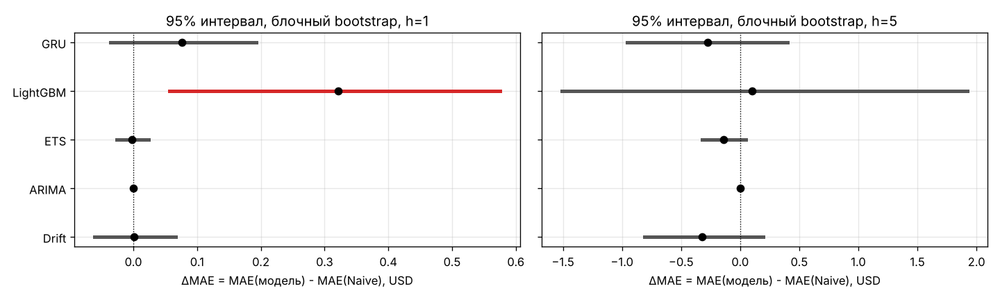
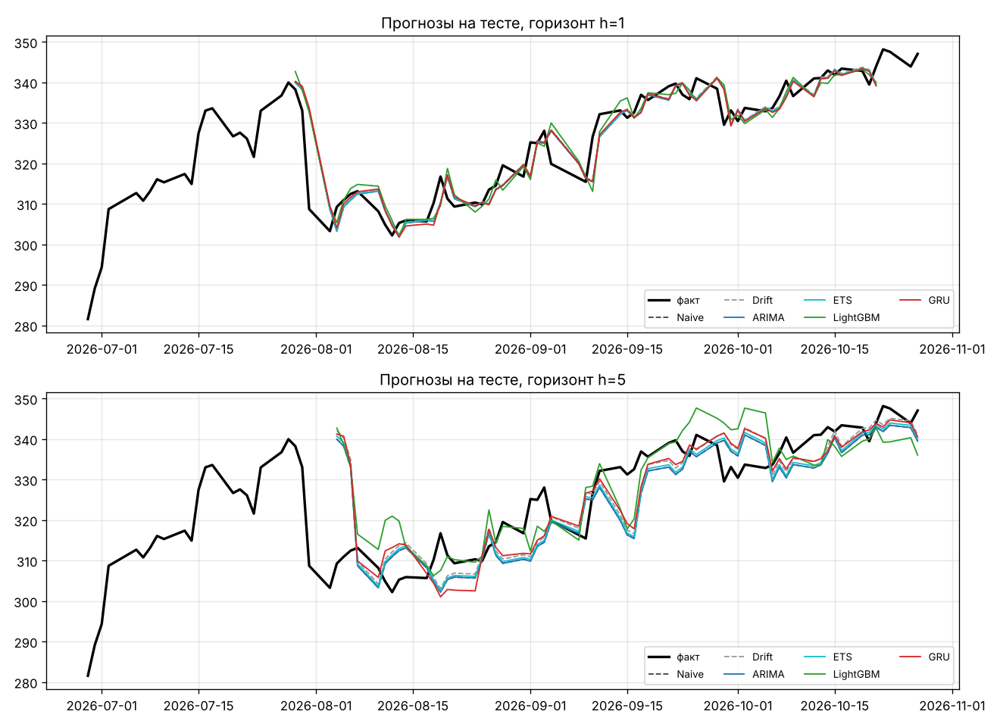
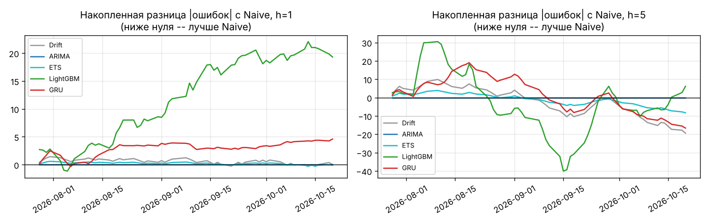
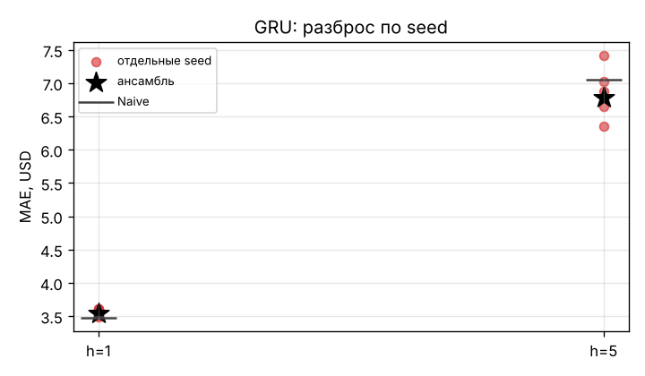

# Прогнозирование дневной цены закрытия AAPL: сравнительное исследование методов

Практики 8-9 курса «Анализ данных и машинное обучение», группа 1 (3 участника: _ФИО_, _ФИО_, _ФИО_).
Инструмент: акции Apple, котировки CFD **AAPL.US/USD** (Dukascopy), 28.10.2025 - 27.10.2026.

**Главный результат.** На тесте из 60 точек прогноза (28.07.2026 - 20.10.2026) ни одна модель
(ARIMA, ETS, LightGBM, GRU) **статистически не превзошла наивный прогноз** «завтра цена как сегодня»
ни на горизонте 1 день, ни на горизонте 5 дней. Это подтверждают два независимых метода:
тест Диболда-Мариано и блочный bootstrap. **LightGBM на горизонте 1 день значимо хуже** наивного прогноза
(DM p = 0.03, 95% интервал ΔMAE = [+0.06; +0.57] USD). Небольшой выигрыш на 5 днях
(Drift -4.6% MAE, GRU -3.9%, ETS -2.0%) не значим и объясняется ростом цены за год (+29%).
Результат согласуется с отсутствием автокорреляции доходностей (тест Льюнга-Бокса, p = 0.50)
и со слабой формой гипотезы эффективного рынка.

Автоматическая сводка всех чисел последнего запуска: [`results/REPORT.md`](results/REPORT.md).
Материалы к защите: [`presentation/DEFENSE.md`](presentation/DEFENSE.md).

---

## Содержание
1. [Постановка задачи и гипотезы](#1-постановка-задачи-и-гипотезы)
2. [Данные](#2-данные)
3. [Описание ряда](#3-описание-ряда)
4. [Схема исследования](#4-схема-исследования)
5. [Методы](#5-методы)
6. [Результаты](#6-результаты)
7. [Устойчивость](#7-устойчивость-результатов)
8. [Вычислительные затраты](#8-вычислительные-затраты)
9. [Обсуждение](#9-обсуждение)
10. [Выводы, ограничения, применение](#10-выводы-ограничения-и-условия-применения)
11. [История проекта: две реализации](#11-история-проекта-две-независимые-реализации)
12. [Воспроизведение](#12-воспроизведение)
13. [Структура репозитория](#13-структура-репозитория)

---

## 1. Постановка задачи и гипотезы

**Задача.** По истории дневных котировок AAPL спрогнозировать цену закрытия на **1 и 5 торговых дней вперед**
и сравнить четыре класса подходов: наивный прогноз, классический статистический метод,
машинное обучение и нейросеть. Прогноз строится после закрытия дня t.

**Исследовательские вопросы**
- В1. Превосходят ли сложные модели наивный прогноз по точности?
- В2. Как меняется качество и соотношение моделей при росте горизонта с 1 до 5 дней?
- В3. Устойчивы ли выводы к выбору тестового подпериода, типа окна обучения и случайной инициализации?
- В4. Оправданы ли вычислительные затраты сложных моделей?

**Гипотезы**
- Г1. Дневные доходности AAPL практически не автокоррелированы, поэтому ни одна модель не даст значимого выигрыша над наивным прогнозом.
- Г2. Ошибка растет с горизонтом примерно пропорционально √h.
- Г3. Гибкие модели (LightGBM, GRU) на ~190 обучающих наблюдениях переобучаются и могут проигрывать простым.

## 2. Данные

| Параметр | Значение |
|---|---|
| Инструмент | AAPL.US/USD, CFD на акции Apple (поток Dukascopy, не биржевые сделки NASDAQ) |
| Источник и команда выгрузки | [`data/SOURCE.md`](data/SOURCE.md) |
| Файл | `data/raw/aaplususd-d1-bid-2025-10-28-2026-10-28.csv`, SHA-256 `3b76bd28...862c7e` |
| Период | 28.10.2025 - 27.10.2026 (12 месяцев на дату выдачи задания) |
| Частота, цена | дневные свечи OHLC, BID, USD |
| Временная зона | UTC; дневная свеча = сутки 00:00-24:00 UTC |
| Наблюдений | 251 торговый день |
| Целевая переменная | цена закрытия `close` |

**Формирование дневной свечи.** Свеча агрегирует котировки CFD за сутки UTC. Американская сессия
(13:30/14:30 - 20:00/21:00 UTC) целиком попадает в эти сутки, поэтому `close` близок к закрытию NASDAQ, но не обязан с ним совпадать.

**Проверка и очистка** (`src/data.py`, отчет `results/cleaning_report.json`). Однозначно исправимое удаляется с записью в отчет,
неоднозначное **останавливает расчет**, чтобы данные сверили с источником вручную:

| Проверка | Действие | Результат на наших данных |
|---|---|---|
| Даты вне периода задания | удалить | 0 |
| Выходные | удалить | 0 (выгрузка уже без них) |
| «Плоские» свечи неторговых дней (`high == low`, объем 0) | удалить | 0 |
| Дубликаты дат | **остановить** | нет |
| Пустые, бесконечные, неположительные цены | **остановить** | нет |
| Нарушение порядка `low ≤ open, close ≤ high` | **остановить** | нет |
| Период не совпадает с заданием | **остановить** | совпадает |
| Пропущенные будни, не являющиеся праздниками Nasdaq/NYSE | **остановить** | все 10 пропусков — праздники |

Пропущенные будни: 27.11.2025, 25.12.2025, 01.01.2026, 19.01.2026, 16.02.2026, 03.04.2026, 25.05.2026, 19.06.2026, 03.07.2026, 07.09.2026.
Они **не заполняются**: ряд индексируется торговыми днями, горизонт h означает h торговых дней.

## 3. Описание ряда



| Характеристика | Значение |
|---|---|
| Цена: начало / конец | 269.01 / 347.04 USD (+29%) |
| Минимум / максимум | 246.53 / 348.15 USD |
| Средняя дневная лог-доходность | 0.10% |
| Дневная / годовая волатильность | 1.53% / 24.2% |
| Асимметрия / избыточный эксцесс доходностей | -0.72 / 4.24 (тяжелые хвосты) |
| Доля дней роста | 53.2% |
| Крупнейшее падение / рост за день | -7.6% (31.07.2026) / +4.8% (02.07.2026) |
| ADF, лог-цена | p = 0.86 — нестационарна |
| ADF, лог-доходности | p < 0.001 — стационарны |
| Льюнг-Бокс, доходности, лаги 5 / 10 | p = 0.56 / 0.50 — автокорреляции нет |
| Автокорреляция доходностей, лаг 1 | 0.027 |



**Вывод для моделирования.** Цена нестационарна, поэтому все модели работают с **лог-доходностями**
(ARIMA с d = 1 на логарифме цены, LightGBM и GRU прогнозируют накопленную лог-доходность `ln(P[t+h]/P[t])`).
Отсутствие автокорреляции доходностей заранее указывает, что предсказуемости по прошлым ценам почти нет (Г1).

## 4. Схема исследования

**Разбиение по времени**

| Часть | Период | Наблюдений |
|---|---|---|
| Начальная обучающая выборка | 28.10.2025 - 28.07.2026 | 187 |
| в т.ч. хвост для подбора гиперпараметров | последние 40 дней этой части | 40 |
| Тест: точки прогноза t | 28.07.2026 - 20.10.2026 | 60 |
| Тест: прогнозируемые даты | h=1: 29.07 - 21.10.2026; h=5: 04.08 - 27.10.2026 | |

**Walk-forward валидация** (`walk_forward` в `src/evaluation.py`). Для каждой точки прогноза t:
модель получает только историю `df[0..t]` (расширяющееся окно), при необходимости переобучается на ней,
строит прогноз на t+1..t+5, прогноз сравнивается с фактом. Набор из 60 точек **одинаков для всех моделей и обоих горизонтов**.

**Частота переобучения** (`REFIT_EVERY` в `src/config.py`): Naive, Drift, ARIMA, ETS, LightGBM — каждый день;
GRU — раз в 5 торговых дней (ежедневное обучение ансамбля из 5 сетей заняло бы ~15 минут).
Во всех случаях используется модель, обученная только на прошлом.

**Защита от утечки будущего**
- модель физически получает только прошлое (`hist`);
- признаки строятся только сдвигами назад (`shift`, `rolling`);
- нормализация для GRU считается по обучающим данным;
- гиперпараметры подбираются один раз на хвосте начальной выборки, до теста; при подборе LightGBM в обучение идут только строки, цель которых целиком заканчивается до начала валидации;
- **автоматическая проверка** (`src/check_leakage.py`, `results/leakage_check.json`): в трех точках теста все строки после t заменяются случайными ценами. Прогноз каждой из 6 моделей и все признаки в точке t не изменились ни на цент. Отдельно проверено, что проверка ловит утечку, если в признак подставить завтрашнюю цену;
- проверка на синтетическом случайном блуждании: ни одна модель не обогнала наивный прогноз (MAE/Naive 0.97-1.08).

**Метрики** (`metrics` в `src/evaluation.py`), где `y` — факт, `ŷ` — прогноз, `P_t` — цена в момент прогноза, n = 60:

| Метрика | Формула | Смысл |
|---|---|---|
| MAE, USD | `(1/n) Σ |ŷ - y|` | средняя ошибка в долларах |
| RMSE, USD | `√((1/n) Σ (ŷ - y)²)` | сильнее штрафует крупные промахи |
| sMAPE, % | `(100/n) Σ 2|ŷ - y| / (|y| + |ŷ|)` | относительная ошибка |
| DirAcc, % | `(100/n) Σ [sign(ŷ - P_t) = sign(y - P_t)]` | угадано ли направление |
| MAE / Naive | `MAE(модель) / MAE(Naive)` | < 1 — лучше baseline |

Для наивного прогноза (и ARIMA(0,1,0)) прогнозное изменение равно 0, поэтому DirAcc **не определена** (прочерк).
Ориентир для DirAcc — доля роста в тесте: 53.3% (h=1) и 66.7% (h=5), то есть результат стратегии «всегда рост».

**Значимость различий с наивным прогнозом** — двумя независимыми способами:
- **тест Диболда-Мариано** с поправкой Harvey-Leybourne-Newbold, потери MSE и MAE, автокорреляция ошибок до лага h-1;
- **круговой блочный bootstrap** 95% интервала для ΔMAE = MAE(модель) - MAE(Naive): длина блока 5 (основная), 1 и 10 (чувствительность), 2000 повторов.

## 5. Методы

| Модель | Тип | Что прогнозирует | Подбор | Переобучение |
|---|---|---|---|---|
| Naive | baseline | `P[t+h] = P[t]` | — | — |
| Drift | baseline | `P[t]·exp(h·μ)`, μ — средняя лог-доходность за всю историю | — | каждый день |
| ARIMA(p,1,q) | статистический | лог-цена | p, q ∈ {0,1,2}, снос да/нет, по AIC | каждый день |
| ETS | статистический | лог-цена, тренд Холта с затуханием | MLE | каждый день |
| LightGBM | ML | накопленная лог-доходность, 5 моделей (прямая стратегия) | сетка 8 комбинаций | каждый день |
| GRU | нейросеть | 5 накопленных лог-доходностей одним выходом | L ∈ {10,20}, hidden ∈ {8,16} | раз в 5 дней |

**ARIMA.** Перебор 18 вариантов на начальной выборке (`results/tuning_arima.csv`). По AIC выбрана
**ARIMA(0,1,0) без сноса** — случайное блуждание, ее прогнозы совпадают с наивными.
Это самостоятельный результат: информационный критерий не нашел в ряду структуры, оправдывающей AR- или MA-члены.

**ETS.** Аддитивный тренд с затуханием, чтобы прогноз не продлевал тренд неограниченно.

**LightGBM.** 22 признака (`src/features.py`): 10 лагов лог-доходности, скользящие среднее и стандартное отклонение
за 5/10/20 дней, отклонение цены от 20-дневной средней, лог-размах `ln(high/low)` с лагами 0-2, `ln(close/open)`, день недели.
Прямая стратегия: отдельная модель на каждый h = 1..5. Работа с доходностями обязательна: деревья не экстраполируют
за диапазон обучения. Выбрано (`results/tuning_lightgbm.csv`): `num_leaves=8, n_estimators=100, learning_rate=0.03,
min_child_samples=20`, плюс `subsample=0.8, colsample_bytree=0.8, reg_lambda=1`.

**GRU.** Вход: окно из L дней × 2 признака (лог-доходность, `ln(high/low)`), стандартизованные по обучающим данным.
Один слой GRU, Dropout 0.2, линейный выход на 5 горизонтов. Adam (lr = 1e-3, weight decay = 1e-4), батч 32,
до 300 эпох, ранняя остановка по последним 15% окон (терпение 25 эпох). Выбрано (`results/tuning_gru.csv`): L = 10, hidden = 8.
Прогноз — среднее ансамбля из 5 сетей с разными seed. Предобученные модели не использовались.

Во всех трех подборах выиграла **самая простая** конфигурация из сетки. Это согласуется с малым объемом данных
и слабым сигналом.

## 6. Результаты

### 6.1. Метрики (`results/metrics.csv`)

**Горизонт h = 1 день**

| Модель | MAE, $ | RMSE, $ | sMAPE, % | DirAcc, % | MAE / Naive |
|---|---|---|---|---|---|
| Naive | 3.469 | **4.990** | 1.071 | — | 1.000 |
| Drift | 3.470 | 5.014 | 1.071 | 53.3 | 1.000 |
| ARIMA(0,1,0) | 3.469 | **4.990** | 1.071 | — | 1.000 |
| ETS | **3.467** | 5.001 | **1.071** | 53.3 | **0.999** |
| LightGBM | 3.791 | 5.315 | 1.170 | 41.7 | 1.093 |
| GRU | 3.546 | 5.107 | 1.095 | 43.3 | 1.022 |

**Горизонт h = 5 дней**

| Модель | MAE, $ | RMSE, $ | sMAPE, % | DirAcc, % | MAE / Naive |
|---|---|---|---|---|---|
| Naive | 7.058 | 9.281 | 2.175 | — | 1.000 |
| Drift | **6.735** | 9.273 | **2.074** | 66.7 | **0.954** |
| ARIMA(0,1,0) | 7.058 | 9.281 | 2.175 | — | 1.000 |
| ETS | 6.920 | 9.255 | 2.132 | 66.7 | 0.980 |
| LightGBM | 7.160 | 9.881 | 2.188 | 55.0 | 1.014 |
| GRU | 6.781 | **9.239** | 2.092 | 60.0 | 0.961 |



### 6.2. Значимость различий с наивным прогнозом

**Тест Диболда-Мариано** (`results/dm_tests.csv`). DM < 0 — модель точнее; p < 0.05 — различие значимо.

| Модель | h=1, MSE | h=1, MAE | h=5, MSE | h=5, MAE |
|---|---|---|---|---|
| Drift | +0.55 (p=0.58) | +0.02 (p=0.98) | -0.02 (p=0.98) | -1.00 (p=0.32) |
| ETS | +0.56 (p=0.58) | -0.13 (p=0.90) | -0.17 (p=0.87) | -1.15 (p=0.25) |
| LightGBM | **+2.19 (p=0.032)** | **+2.26 (p=0.028)** | +0.61 (p=0.54) | +0.09 (p=0.93) |
| GRU | +1.73 (p=0.09) | +1.64 (p=0.11) | -0.09 (p=0.93) | -0.65 (p=0.52) |
| ARIMA | совпадает с Naive | | | |

**Блочный bootstrap, 95% интервал ΔMAE, USD, блок 5** (`results/bootstrap_ci.csv`, график ниже).
Интервал целиком ниже 0 — модель лучше; выше 0 — хуже; содержит 0 — различие не доказано.

| Модель | h=1: ΔMAE [интервал] | вывод | h=5: ΔMAE [интервал] | вывод |
|---|---|---|---|---|
| Drift | +0.001 [-0.06; +0.07] | не различимо | -0.32 [-0.81; +0.20] | не различимо |
| ETS | -0.002 [-0.03; +0.02] | не различимо | -0.14 [-0.32; +0.05] | не различимо |
| LightGBM | +0.32 [+0.06; +0.57] | **хуже** | +0.10 [-1.51; +1.92] | не различимо |
| GRU | +0.08 [-0.04; +0.19] | не различимо | -0.28 [-0.96; +0.40] | не различимо |



**Оба метода согласны:** ни одна модель значимо не лучше наивного прогноза; LightGBM на h=1 значимо хуже.

**Почему важна длина блока.** У ETS на h=5 при блоке 1 (обычный bootstrap, соседние ошибки считаются независимыми)
интервал [-0.27; -0.004] целиком ниже нуля, то есть «ETS лучше». При блоках 5 и 10 интервал [-0.32; +0.05] содержит ноль.
Ошибки соседних 5-дневных прогнозов зависимы (их периоды перекрываются на 4 дня), и если это игнорировать,
получается ложная значимость. Поэтому основной выбран блок длиной 5, равный горизонту.

### 6.3. Прогнозы и ошибки



На h=1 все прогнозы фактически повторяют вчерашнюю цену со сдвигом на день — типичная картина для случайного блуждания:
модель не предсказывает изменение, а «запаздывает» за фактом.



Накопленная разница абсолютных ошибок с наивным прогнозом (ниже нуля — модель лучше):
- h=1: LightGBM проигрывает почти с начала теста и отрыв растет до конца; GRU проигрывает умеренно; Drift и ETS около нуля;
- h=5: Drift, ETS и GRU уходят ниже нуля только с сентября, в период устойчивого роста цены; LightGBM сильно колеблется в обе стороны.

### 6.4. Влияние горизонта и направление

MAE наивного прогноза растет с 3.47 $ (h=1) до 7.06 $ (h=5), в 2.03 раза. Для случайного блуждания
ожидается √5 ≈ 2.24: стандартное отклонение суммы 5 независимых дневных изменений в √5 раз больше одного (Г2 подтверждена).
С ростом горизонта немного выигрывают модели, учитывающие тренд (Drift, ETS, GRU): систематический снос за 5 дней
накапливается, а на 1 дне тонет в шуме.

Точность направления Drift и ETS (53.3% на h=1, 66.7% на h=5) в точности равна доле роста в тесте:
обе модели прогнозировали рост **во всех 60 точках**. GRU прогнозировал рост в 57% точек на h=1 и 90% на h=5,
LightGBM в 55% и 82%. Ни одна модель не угадывает направление лучше стратегии «всегда рост»;
LightGBM и GRU на h=1 (41.7% и 43.3%) — хуже подбрасывания монеты.

## 7. Устойчивость результатов

### 7.1. Подпериоды теста (`results/robust_subperiods.csv`)

Тест разбит на 3 блока по 20 точек. Ранг по MAE (1 — лучшая модель; совпадающие модели получают одинаковый ранг):

| Модель | h=1: блок 1 | блок 2 | блок 3 | h=5: блок 1 | блок 2 | блок 3 |
|---|---|---|---|---|---|---|
| Naive / ARIMA | 1 | 4 | 3 | 1 | 5 | 4 |
| Drift | 4 | 1 | 2 | 5 | 3 | 1 |
| ETS | 3 | 3 | 1 | 4 | 4 | 3 |
| LightGBM | 6 | 6 | 5 | 3 | 1 | 6 |
| GRU | 5 | 2 | 6 | 6 | 2 | 2 |

Устойчиво лучшей модели нет: лидер меняется от блока к блоку. Устойчиво лишь то, что LightGBM на h=1 последний или предпоследний.
В блоке 1 (резкое падение цены 31.07) на h=5 лучший — наивный прогноз, а трендовые модели и GRU — в конце списка.

### 7.2. Тип окна обучения (`results/robust_window.csv`)

Скользящее окно 150 дней вместо расширяющегося, гиперпараметры те же. MAE, USD:

| Модель | h=1: расширяющееся → скользящее | h=5: расширяющееся → скользящее |
|---|---|---|
| Naive / ARIMA | 3.469 → 3.469 | 7.058 → 7.058 |
| Drift | 3.470 → 3.466 | 6.735 → 6.606 |
| ETS | 3.467 → 3.470 | 6.920 → 6.710 |
| LightGBM | 3.791 → 3.804 | 7.160 → 7.235 |
| GRU | 3.546 → 3.470 | 6.781 → 6.384 |

На h=1 выводы не меняются. На h=5 скользящее окно улучшает трендовые модели и GRU: короткое окно сильнее отражает
недавний рост. Это еще одно указание, что выигрыш на h=5 связан с трендом конкретного периода.
ARIMA на скользящем окне снова выбрала (0,1,0).

### 7.3. Случайная инициализация нейросети (`results/robust_gru_seeds.csv`)



| | h=1, MAE | h=5, MAE |
|---|---|---|
| 5 отдельных сетей | 3.48 - 3.62 | 6.35 - 7.42 |
| Ансамбль (среднее) | 3.55 | 6.78 |
| Naive | 3.47 | 7.06 |

На h=1 все 5 сетей хуже наивного прогноза. На h=5 разброс между seed (1.07 $) почти в 4 раза больше выигрыша ансамбля
над наивным прогнозом (0.28 $): результат одной сети в значительной мере определяется случайностью, ансамбль необходим.

## 8. Вычислительные затраты

Весь тест, 60 точек, один процессор (`results/timing.csv`; от запуска к запуску немного меняется):

| Модель | Обучений | Обучение, с | Прогноз, с | Всего, с |
|---|---|---|---|---|
| Naive | — | 0 | 0.002 | ≈ 0 |
| Drift | 60 | 0.002 | 0.003 | ≈ 0 |
| ETS | 60 | 0.9 | 0.13 | 1.1 |
| ARIMA | 60 | 2.7 | 0.07 | 2.7 |
| LightGBM | 60 × 5 моделей | 8.0 | 0.7 | 8.7 |
| GRU | 12 × 5 сетей | 87.7 | 0.17 | 87.9 |

Без учета подбора гиперпараметров. GRU в ~30 раз дороже ARIMA и в ~10 раз дороже LightGBM, не давая значимого выигрыша.

## 9. Обсуждение

**Почему сложные модели не выигрывают.** Доходности AAPL не автокоррелированы (Льюнг-Бокс p = 0.50, ACF(1) = 0.03):
прошлые цены почти не содержат информации о будущих изменениях. Это слабая форма гипотезы эффективного рынка:
если бы предсказуемость была, участники рынка использовали бы ее, и она исчезла бы. Лучшее, что модель может сделать, —
повторить последнюю цену. Поиск закономерностей там, где их нет, ведет к подгонке под шум.

**Почему LightGBM и GRU хуже на h=1.** На ~190 наблюдениях с отношением сигнал/шум, близким к нулю, гибкие модели
выучивают случайные паттерны обучающей выборки. Их прогнозы изменения ненулевые, но не связаны с фактическими
изменениями, и это лишь добавляет к ошибке дисперсию. Выбор при подборе самых простых конфигураций — косвенный признак того же.

**Почему трендовые модели немного выигрывают на h=5.** За год цена выросла на 29%, тестовый период после падения
в конце июля — период роста. Модели, экстраполирующие положительный снос, получили преимущество.
Оно не подтверждено статистически, неустойчиво по подпериодам и исчезает в периоде падения (блок 1).
При нисходящем тренде эффект, вероятно, сменился бы на противоположный.

**Что подтверждено экспериментально, а что — гипотезы**
- *Подтверждено:* ни одна модель значимо не лучше наивного прогноза (DM и bootstrap); LightGBM значимо хуже на h=1;
  ошибка растет с горизонтом близко к √h; ARIMA по AIC выбирает случайное блуждание; результат GRU заметно зависит от seed;
  прогнозы не зависят от будущих данных (проверка на утечку).
- *Гипотезы, не проверенные напрямую:* выигрыш трендовых моделей на h=5 вызван ростом цены в тестовом периоде;
  с более длинной историей или внешними признаками сложные модели могли бы выиграть.

**Ответы на исследовательские вопросы:** В1 — нет (Г1 подтверждена); В2 — ошибка растет примерно как √h,
на h=5 трендовые модели незначимо выигрывают (Г2 подтверждена); В3 — ранжирование неустойчиво,
устойчив только проигрыш LightGBM на h=1; В4 — нет, затраты выше на порядки без выигрыша (Г3 подтверждена).

## 10. Выводы, ограничения и условия применения

**Выводы**
1. Для прогноза дневной цены закрытия AAPL на 1-5 дней по истории цен наивный прогноз остается сильнейшим практическим
   ориентиром: ARIMA, ETS, LightGBM и GRU значимо его не превосходят.
2. Рекомендуемый метод — **наивный прогноз**: та же точность при нулевых затратах и полной интерпретируемости.
   На горизонте 5 дней допустимы Drift или ETS, но их выигрыш (2-5% MAE) незначим и зависит от направления тренда.
3. Рост сложности модели на годовой выборке не повышает точность, а увеличивает риск переобучения и зависимость от случайности.

**Ограничения**
- Один год данных (251 наблюдение); тест из 60 точек дает низкую мощность статистических тестов.
- Один инструмент и один рыночный режим (рост цены).
- Котировки CFD Dukascopy, а не биржевые цены NASDAQ; корпоративные корректировки не выполнялись.
- Только ценовые признаки: нет объемов, отчетности, новостей, индексов.
- Перекрывающиеся 5-дневные прогнозы зависимы; это учтено в DM и блочном bootstrap, но эффективный объем выборки меньше 60.
- Поправка на множественные сравнения (5 моделей × 2 горизонта) не делалась; с ней значимость LightGBM на h=1 ослабла бы.
- Гиперпараметры подбирались один раз на начальной выборке и на небольших сетках; GRU переобучалась раз в 5 дней.

**Условия практического применения.** Модели не следует использовать для торговли: точность направления не превосходит
стратегию «всегда рост», а спред, комиссии и стоимость удержания CFD не учитывались. Результат полезен как обоснованный
baseline для будущих исследований. Для практической пользы нужны внешние признаки, более длинная история,
прогноз волатильности и интервальные прогнозы вместо точечных.

## 11. История проекта: две независимые реализации

Проект собран из двух независимых реализаций, сделанных в группе. Обе работали на одном и том же файле котировок
(цены совпадают полностью, отличается только объем в одной строке, который не используется).

| | Вариант 1 (основа) | Вариант 2 |
|---|---|---|
| Модели | Naive, Drift, ARIMA (AIC), ETS, LightGBM, GRU | Naive, AR(1) по МНК, RandomForest, MLP |
| Подбор гиперпараметров | на хвосте обучающей выборки | заданы вручную |
| Тест | 60 точек с 28.07.2026 | 71 точка с 13.07.2026 |
| Значимость | тест Диболда-Мариано | блочный bootstrap |
| Вывод | значимого выигрыша нет | значимого выигрыша нет |

В итоговую версию из варианта 2 перенесены: строгие проверки данных с остановкой расчета, сверка пропусков
с календарем бирж, контрольная сумма SHA-256 и `metadata.json`, автоматическая проверка на утечку будущего,
блочный bootstrap как второй метод проверки значимости, автоматический отчет `REPORT.md`, материалы к защите.
По сравнению с первой версией LightGBM переобучается ежедневно (было раз в 5 дней), GRU — раз в 5 дней (было раз в 20).
История изменений — в журнале git.

То, что две реализации с разными моделями, признаками и тестовыми периодами пришли к одному выводу, —
дополнительный аргумент в пользу его надежности. В варианте 2 AR(1) на h=5 также дала незначимый выигрыш
(ΔMAE = -0.25 $, интервал [-0.71; +0.23]) и также прогнозировала рост во всех точках, как Drift и ETS здесь.

## 12. Воспроизведение

Python 3.10+ (проверено на Python 3.13, Linux, и Python 3.14, macOS).

```bash
git clone <ссылка на репозиторий>
cd aapl-forecast
./run.sh          # создает .venv, ставит зависимости, запускает эксперимент (~4 минуты)
```
или вручную:
```bash
python3 -m venv .venv && source .venv/bin/activate
pip install -r requirements.txt        # или requirements-lock.txt для точных версий
python src/run_all.py
```

Все seed зафиксированы; метрики воспроизводятся до последнего знака (проверено на Linux и macOS).
Время работы моделей от запуска к запуску немного меняется. Отдельно проверку на утечку можно запустить
командой `python src/check_leakage.py`. Если на macOS LightGBM выдает ошибку про `libomp`: `brew install libomp`.

## 13. Структура репозитория

```
aapl-forecast/
├── README.md                   аналитический отчет (этот файл)
├── requirements.txt            минимальные версии зависимостей
├── requirements-lock.txt       точные версии, на которых получены результаты
├── run.sh                      запуск всего эксперимента одной командой
├── data/
│   ├── SOURCE.md               источник, команда выгрузки, контрольная сумма, календарь
│   ├── raw/                    исходная выгрузка Dukascopy (без изменений)
│   └── aapl_d1_clean.csv       очищенный ряд
├── src/
│   ├── config.py               общие настройки: период, праздники, горизонты, seed, частота переобучения
│   ├── data.py                 загрузка, проверка и очистка
│   ├── features.py             признаки для LightGBM
│   ├── models.py               Naive, Drift, ARIMA, ETS, LightGBM, GRU
│   ├── evaluation.py           walk-forward, метрики, тест Диболда-Мариано, блочный bootstrap
│   ├── check_leakage.py        проверка на утечку будущего
│   ├── report.py               автоматическая сводка REPORT.md
│   └── run_all.py              полный прогон
├── results/
│   ├── REPORT.md               автоматическая сводка всех чисел
│   ├── metrics.csv, predictions.csv, dm_tests.csv, bootstrap_ci.csv
│   ├── robust_*.csv            проверки устойчивости
│   ├── tuning_*.csv, chosen_hyperparams.json
│   ├── leakage_check.json, metadata.json, cleaning_report.json, eda_stats.json, timing.csv
│   └── figures/                графики 01-07
├── notebooks/
└── presentation/
    └── DEFENSE.md              план выступления, вопросы и ответы, оппонирование
```
